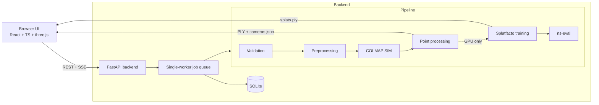

# SpatialForge, explained

*A complete walkthrough of the project: what it is, how it works, why it is
built the way it is, and what has actually been verified.*

---

## 1. What SpatialForge is

SpatialForge is a web application that turns **unordered photographs into an
interactive 3D scene**. You upload 20–150 overlapping photos of an object —
taken with any camera, in any order, with no metadata — and the system:

1. validates and normalizes them,
2. recovers the **camera pose** (position + orientation) of every photo,
3. reconstructs a **sparse 3D point cloud** of the scene,
4. refines and exports that geometry,
5. optionally trains a **3D Gaussian Splatting** neural scene on a GPU,
6. lets you orbit, inspect and export the result in the browser.

Every piece of geometry is derived from the pixels of the uploaded images by
real Structure-from-Motion. There are no placeholder meshes, no simulated
progress bars, and no invented numbers — wherever something cannot be
computed (e.g. neural metrics on a CPU-only machine), the UI says
"Not available" and explains why.

It is designed **laptop-first**: the entire geometric pipeline runs on an
ordinary CPU. GPU support (local NVIDIA or Google Colab) is an optional
extension that is *detected*, never assumed.

---

## 2. The problem, and why it is interesting

Given N photographs of a static scene taken from unknown viewpoints,
Structure-from-Motion (SfM) answers two questions simultaneously:

- **Where was each camera?** (pose estimation)
- **What does the world look like?** (sparse geometry)

It does this without any depth sensors: matching *feature points* (SIFT
keypoints — distinctive local patterns robust to scale/rotation/lighting)
between overlapping images creates 2D correspondences; geometric verification
filters bad matches (e.g. repeated textures); and **incremental mapping**
seeds a model from a well-conditioned image pair, triangulates 3D points,
registers remaining images one by one via Perspective-n-Point pose solving,
and polishes everything with **bundle adjustment** — a joint nonlinear least
squares over all camera parameters and 3D points that minimizes total
reprojection error.

This is the geometric foundation under robotics mapping, digital twins,
AR/VR content capture, NeRF/Gaussian-Splatting dataset preparation, and
photogrammetry generally. It is also fiddly engineering: subprocess
orchestration, binary file formats, coordinate-convention traps, and failure
modes that must be *explained* to users rather than silently swallowed.

SpatialForge wraps a proven SfM engine (COLMAP) in honest orchestration, adds
the modern neural-rendering half (Gaussian Splatting via Nerfstudio) where
hardware allows, and presents everything through a professional UI and REST
API.

---

## 3. Big picture



**One reconstruction, end to end:**

1. `POST /api/projects` creates a project row and its on-disk folder.
2. `POST /api/projects/{id}/images` ingests files or ZIPs → originals are
   stored untouched, each image is inspected (readable? sharp? too dark? a
   near-duplicate?) and the report is shown in the UI before anything
   expensive happens.
3. `POST /api/projects/{id}/reconstruct` queues a job. The single worker
   executes the pipeline, streaming stage transitions, progress (0→1) and
   every COLMAP log line to the DB and to any connected browser via SSE.
4. COLMAP runs in four steps: `feature_extractor` → matcher → `mapper` →
   `image_undistorter`. The binary sparse model is parsed in pure Python and
   converted into viewer-ready artifacts: `sparse_cloud.ply`,
   `refined_cloud.ply`, `cameras.json`, `scene_meta.json`.
5. The frontend viewer (three.js) loads the PLY directly and draws one
   frustum per registered camera from `cameras.json` — the classic
   photogrammetry "camera orbit" view.
6. If a CUDA GPU with Nerfstudio is present *and* the user chose GPU mode,
   Splatfacto trains on the undistorted dataset, `ns-eval` scores held-out
   views, and the exported `splats.ply` unlocks the Gaussian-splat display
   mode.

---

## 4. The pipeline stages in detail

Code lives under `backend/app/reconstruction/`. Each sub-package is one stage
with an explicit contract; the HTTP layer contains zero reconstruction logic.

### 4.1 Ingestion & validation — `preprocessing/validation.py`, `services/upload_service.py`

- Accepts JPEG/PNG/WebP files and ZIP archives (batch uploads; ≤ 300 images).
- Every file is checked for readability, minimum resolution, and openable
  EXIF. **Blur** is estimated by the variance of the Laplacian (a sharp image
  has strong gradient energy; motion blur collapses it). **Dark frames** are
  flagged via mean brightness. **Near-duplicates** are detected with a 64-bit
  difference hash (dhash) — duplicates add no new viewpoints and bias
  matching.
- Nothing is rejected silently: every warning is surfaced in the upload
  report (this feeds the "capture tips" UX). The dataset summary warns about
  small collections, blurry share, and duplicates.
- ZIPs are extracted through a hardened path
  (`utils/security.py`): absolute paths, `..` traversal, drive letters,
  > 500 members, > 2 GB expansion and > 200× compression ratios are all
  rejected (zip-bomb guard). A dedicated test suite attacks this module.

### 4.2 Preprocessing — `preprocessing/preprocess.py`

Originals are never modified. Derivatives are written to `images/`: EXIF
orientation applied (a photo stored rotated must actually *be* rotated before
SIFT, or every pose is wrong), longest edge bounded (default 1600 px, Lanczos
resampling to preserve SIFT-friendly texture), encoded as quality-92 JPEG.
A mapping file records what was derived from what. `images/` is emptied and
regenerated on every run, so a re-run reproduces the same file names instead
of accumulating `*_1.jpg` copies. The COLMAP database and models are cached
between runs only while `colmap/inputs.json` (a fingerprint of the processed
image set) still matches; any change to the inputs rebuilds them.

### 4.3 COLMAP SfM — `colmap/commands.py`, `colmap/runner.py`

- `commands.py` builds the exact CLI invocations as **pure functions**, so
  they are unit-tested without COLMAP installed. It carries a `ColmapProfile`
  abstraction because **COLMAP 4.x renamed its option groups**
  (`--SiftExtraction.*` → `--FeatureExtraction.*`, `--SiftMatching.*` →
  `--FeatureMatching.*`); the profile is detected once from the binary's
  version banner, so 3.8+ and 4.x both work. SIFT parameters themselves
  (`--SiftExtraction.max_num_features`) kept their name across versions —
  discovering exactly which options moved required probing the real binary.
- Matching strategy: **exhaustive** for ≤ 120 images (all 2,701 pairs of a
  74-image set still fit comfortably), otherwise sequential-with-quadratic-
  overlap or vocab-tree for larger sets.
- `runner.py` executes COLMAP as a subprocess with: streamed line-by-line
  output (becomes the UI's log console), exit-code checking with the last
  30 output lines attached to the error, DLL resolution on Windows (the
  executable's own directory is prepended to PATH), and **cooperative
  cancellation** — a `threading.Event` checked during execution; on cancel,
  the whole process *tree* is killed (psutil), so no orphan COLMAP survives.
- Failure messages are written for humans: "COLMAP registered no images…
  capture 30–80 sharp, well-overlapping photos" instead of exit code 1.

### 4.4 Binary model parsing — `colmap/parser.py`

Rather than requiring the `pycolmap` package (a compiled dependency with its
own version matrix), SpatialForge parses COLMAP's documented binary model
formats directly:

- `cameras.bin` — per-camera model id, resolution, intrinsics (12 supported
  models; single-focal models like SIMPLE_RADIAL are classified explicitly so
  `fx/fy/cx/cy` extraction is correct).
- `images.bin` — per-image quaternion (w, x, y, z) + translation + observed
  2D points (parsed as an interleaved structured array: x, y, point3D_id —
  reading them as two contiguous arrays was a real bug the fixture test
  caught).
- `points3D.bin` — xyz, RGB, per-point mean reprojection error and track
  length (these feed the metrics panel).

Two format generations are supported transparently: COLMAP 3.x writes the
entry count of cameras/images as **uint32**, 4.x as **uint64**. The parser
tries the 4.x layout first and only accepts a parse that consumes the buffer
*exactly*; otherwise it falls back — verified against both hand-built
fixtures and COLMAP 4.2.1's own `model_converter` output.

### 4.5 Coordinate transforms — `colmap/transforms.py`

The subtlest part of any SfM pipeline. COLMAP stores **world-to-camera**
poses in an OpenCV camera frame (x right, y down, z forward) with Hamilton
(w,x,y,z) quaternions. three.js (and Nerfstudio) want **camera-to-world**
matrices in an OpenGL frame (x right, y up, z backward). The conversion is:

```
C2W_cv = [Rᵀ | −Rᵀ t]                 # invert the rigid transform
C2W_gl = C2W_cv · diag(1, −1, −1, 1)  # flip the camera's y/z axes
```

The camera center is identical in both frames — asserted by test. Because a
reconstruction has arbitrary gauge (COLMAP may output any rotation/scale/
offset), comparing estimated poses to ground truth is only meaningful **after
a 7-DoF similarity alignment** (Umeyama/Procrustes: rotation, translation,
uniform scale). That machinery lives here too and is exercised by the
integration test (see §8).

A war story that validates the design: during development, pose verification
showed a systematic ~122° error. The parser matched COLMAP's own converter
exactly; projected GT corners landed pixel-perfect on the images. The real
cause was the *dataset generator* building camera bases with
`y = cross(x, forward)` — an **improper (left-handed) triad in coordinates**.
COLMAP assumes right-handed frames, so it converged to the mirror-image
world — a mathematically legal solution that reprojected fine. The fix
(z-up world, `x = forward × up`, `y = forward × x`) is why the generator now
documents its handedness and why the GT-pose test exists at all.

### 4.6 Point-cloud processing — `geometry/pointcloud.py`, `geometry/exporter.py`

Open3D performs statistical outlier removal (drop points whose mean k-NN
distance is > 2σ above the cloud average — kills floaters) and voxel
downsampling (bounded resolution for storage/viewing). A **pure-NumPy
fallback** with equivalent semantics runs when Open3D has no wheel for the
Python version — the active backend is reported in the metrics. The sparse
cloud (with per-point reprojection error as a scalar property) and the
refined cloud are exported as binary little-endian PLY, plus a decimated
"viewer cloud" when a dataset produces millions of points.

### 4.7 Gaussian Splatting — `gaussian/presets.py`, `gaussian/nerfstudio.py`

3D Gaussian Splatting (Kerbl et al. 2023) represents the scene as millions of
anisotropic colored, alpha-blended 3D Gaussians, optimized by photometric
gradient descent — sharp, real-time novel views, better than NeRF in practice
for capture workloads. SpatialForge treats it as an **optional stage**:

- The pipeline already writes the Nerfstudio-ready COLMAP layout
  (`undistorted/images` + `undistorted/sparse`), so training is a straight
  `ns-train splatfacto --data …`.
- Three presets (Fast Preview 7k iters / Balanced 15k / High Quality 30k)
  map to iterations, image downscaling and densification thresholds; on
  small GPUs (< 6 GB) the preset is auto-reduced rather than OOM-ing.
- Orchestration runs `ns-train` → `ns-eval` (held-out PSNR/SSIM/LPIPS) →
  `ns-export gaussian-splat`, streams logs, parses progress lines, and
  copies the exported `splats.ply` into the project artifacts.
- **Capability-gated**: without torch+CUDA+Nerfstudio the stage records
  `status: not_available` with the reason, the UI shows the Colab path, and
  no numbers are fabricated.

### 4.8 Evaluation — `evaluation/metrics.py`, `evaluation/holdout.py`

PSNR and SSIM are implemented directly (NumPy/OpenCV — SSIM follows Wang et
al. 2004 with an 11×11 Gaussian window) so they work in CPU mode. LPIPS is
used only when torch+lpips exist. Holdout selection is deterministic
(SHA-256 ordering of filenames; fraction 0.1, only for ≥ 10 images) so a
split is reproducible across runs. Novel-view numbers come from `ns-eval` on
the trained model — training-image reconstruction is never presented as
novel-view performance.

---

## 5. Backend design

**FastAPI + SQLite, deliberately small.** The persistence layer
(`db.py`) uses the standard-library `sqlite3` with a lock-guarded connection —
six tables (`projects`, `images`, `jobs`, `logs`, `metrics`, `artifacts`) and
explicit schema. All state survives restarts; jobs caught mid-flight at
startup are marked failed as "interrupted by server restart".

**Single-worker job queue** (`services/job_manager.py`): exactly one heavy
job runs at a time (FIFO). Two SfM runs or two CUDA trainings fighting for a
laptop is a design failure, not a scheduling hiccup. Each job gets a context
object providing `stage()`, `progress()`, `log()` and cancellation; every
transition is both persisted and published.

**Live updates** (`services/event_bus.py`): pipeline code publishes typed
events (`stage`, `progress`, `log`, `status`, `done`, `error`) through a
thread-safe bus into per-project asyncio queues; the `/events` endpoint
streams them as Server-Sent Events with keepalives. The frontend also keeps
a 4 s polling fallback while a job is active — SSE is the fast path, not a
single point of failure.

**Security posture** (a localhost app, but hardened as a matter of craft):
ZIP bombs and traversal rejected up front; artifact/image file routes resolve
paths **only** through a DB lookup and re-validate containment; filenames
containing separators or `..` are rejected explicitly; the SPA fallback
refuses to swallow `api/*` or traversal paths (a test caught the HTML
fallback answering a traversal request with a 200 — no leak, but wrong
surface); no filesystem paths or tokens are exposed through the API.

**Versioned, typed contract**: `schemas.py` (Pydantic v2) defines every
request/response; `frontend/src/types/index.ts` mirrors it. The OpenAPI UI
comes free at `/docs`.

---

## 6. Frontend design

React 18 + TypeScript + Vite, styled with Tailwind in a dark
charcoal/cyan "engineering workstation" language. No state library needed —
server state dominates, so a typed `fetch` client plus the `useLiveProject`
hook (SSE + polling fallback + log windowing) covers it.

Five surfaces:

- **Dashboard** — project cards with real stats (images, points, runtime),
  live capability chip in the sidebar (OS / cores / RAM / GPU).
- **New Reconstruction** — drag-drop + ZIP upload with per-batch progress
  (XHR), the validation report, preset and execution-mode pickers where
  unavailable modes are *disabled with the reason*.
- **Pipeline tab** — the ten-stage stepper (Upload → … → Export), progress
  bar driven by actual job progress, and the raw COLMAP log console for the
  current run. Stages that did not run (training in CPU mode) show as
  *skipped*.
- **3D Viewer** — R3F scene: point clouds loaded through a hand-written
  binary-PLY parser (`viewers/plyLoader.ts`) into `THREE.Points`, camera
  frustums built from `cameras.json` (position + FOV-true pyramids; the
  file stores `c2w` row-major, so it is loaded with `Matrix4.set`, not the
  column-major `fromArray`), grid,
  background select, screenshot capture (WebGL buffer preserved), and
  auto-framing to the cloud's bounding sphere. The splat mode mounts
  `@mkkellogg/gaussian-splats-3d` — real anisotropic Gaussian rendering —
  only when a `splats.ply` artifact exists.
- **Analytics** — reconstruction statistics (registration ratio, tracks,
  observations, reprojection error, refinement report), training status, and
  held-out evaluation metrics, with "Not available" where the truth is
  "not computed".

The built SPA is served by the backend itself (`frontend/dist`), so
production is one port and one process.

---

## 7. Hardware modes and capability detection

`config.py`'s `capabilities()` probes, without assuming anything:

- OS / Python / CPU / RAM / disk (psutil),
- NVIDIA GPUs via `nvidia-smi` (name, VRAM, compute capability),
- COLMAP (PATH + known install locations, version banner),
- Open3D / torch / CUDA / Nerfstudio / LPIPS (imports and CLI checks).

Resulting mode switches:

| mode | needs | what you get |
|---|---|---|
| CPU reconstruction | COLMAP | everything geometric; verified path |
| Local GPU training | torch+CUDA + Nerfstudio | adds Splatfacto + ns-eval + splats |
| Colab GPU training | a browser | the bundled notebook; artifacts come back as a ZIP |

`python scripts/detect_env.py` prints the same report the API serves at
`/api/system/capabilities`.

---

## 8. The dataset, the demo, and the tests

**Synthetic ground-truth dataset** (`scripts/generate_synthetic_dataset.py`):
a procedurally textured cube on a checkered ground plane, rendered from a
36-view orbit (800×600, known pinhole intrinsics) with per-view exposure
variation — by pure NumPy/OpenCV homography rendering. It is license-clean
(generated, not downloaded), SIFT-rich, and ships `gt_poses.json` with exact
camera-to-world matrices.

**Demo mode**: `scripts/prepare_demo.py` chains dataset → ingestion → full
pipeline → a demo-flagged project, so a fresh clone shows a real
reconstruction without any downloads. An optional
`scripts/fetch_sample_dataset.py` targets openly licensed real-photo datasets
with citations.

**Testing philosophy** — mock only the boundary:

- **Unit (61)**: ZIP security attacks, blur/duplicate detection, both COLMAP
  command profiles, binary parsing against hand-built fixtures (including
  both header widths), quaternion/matrix round-trips, the OpenCV→OpenGL
  conversion, similarity alignment recovery, point-cloud semantics (also with
  the NumPy fallback forced), PLY bytes, metric sanity, deterministic
  holdout, and the full API surface through `TestClient` (upload, validation,
  job lifecycle with a stubbed pipeline, failure surfacing, 404/409 paths,
  artifact guards).
- **Integration (1, `@pytest.mark.integration`)**: the *real* pipeline with
  *real* COLMAP on a generated dataset, asserting artifacts exist, metrics
  are sane, and — the centerpiece — **estimated poses match ground truth
  after 7-DoF alignment** (mean rotation error 0.32°, center error 3 cm on a
  2.1 m orbit, 36/36 cameras). Missing COLMAP ⇒ explicit skip, never a fake
  pass.

**Verified results** (Windows 10, i5-12500H, COLMAP 4.2.1 CPU, Open3D 0.19):

| measurement | value |
|---|---|
| images registered | 36/36 |
| sparse points | ~3,200 |
| mean reprojection error | 0.41 px |
| CPU pipeline runtime (incl. matching) | ~21 s |
| pose error vs ground truth | 0.32° mean rotation · 3 cm mean center |
| Open3D refinement | 2,984 → 1,953 points |

No GPU-training benchmark is claimed — that path runs on Colab, and its
numbers belong there once produced.

---

## 9. Where everything lives

```
├── backend/app/
│   ├── config.py                  settings + capability detection
│   ├── db.py                      SQLite schema + DAO
│   ├── schemas.py                 Pydantic API contracts
│   ├── main.py                    app factory, CORS, SPA hosting
│   ├── cli.py                     serve / capabilities / demo commands
│   ├── api/                       projects (REST + SSE) and system routes
│   ├── services/                  job manager, event bus, uploads, serialization
│   ├── reconstruction/
│   │   ├── preprocessing/         validation + EXIF-safe resizing
│   │   ├── colmap/                commands, runner, binary parser, transforms
│   │   ├── geometry/              point clouds + PLY/JSON exporters
│   │   ├── gaussian/              presets + ns-train/ns-eval/ns-export
│   │   └── evaluation/            PSNR/SSIM/LPIPS, holdout
│   └── utils/                     path safety, secure ZIP, logging
├── frontend/src/
│   ├── pages/                     Dashboard, NewProject, ProjectWorkspace
│   ├── viewers/                   plyLoader, SceneViewer (R3F), SplatViewer
│   ├── services/api.ts            typed REST + SSE client
│   ├── hooks/useLiveProject.ts    live job state
│   └── types/index.ts             mirror of the backend contract
├── notebooks/SpatialForge_Colab.ipynb   GPU workflow (14 cells)
├── scripts/                       env detection, COLMAP installer, dataset
│                                  generator, demo prep, HF up/download
├── tests/unit, tests/integration  61 + 1 tests
├── docs/                          installation, architecture, coordinates,
│                                  colab, evaluation, troubleshooting
└── assets/                        real screenshots
```

**On-disk data layout** (per project, under `data/projects/<id>/`):
`originals/` (untouched uploads) → `images/` (processed derivatives) →
`colmap/` (`database.db`, `sparse/`, `undistorted/`) → `artifacts/` (PLY,
`cameras.json`, `scene_meta.json`, `splats.ply`) → `outputs/` (Nerfstudio
checkpoints, GPU path only).

---

## 10. Design decisions and their trade-offs

| decision | why | trade-off accepted |
|---|---|---|
| COLMAP via CLI subprocess, not pycolmap | zero compiled Python deps; works with any COLMAP build; commands are testable strings | no in-process access to COLMAP internals |
| Pure-Python binary model parser | installable everywhere; unit-testable offline | ~seconds for very large models |
| Single-worker queue | protects laptop CPU/GPU from job stampedes | throughput, irrelevant for a workstation app |
| SQLite over a server DB | zero-config persistence that survives restarts | single-host only (by design) |
| SSE over WebSockets | one-way fits the use case; survives proxies better | client can't push (cancellation is REST) |
| NumPy fallback for Open3D | installs succeed on any Python | slower on huge clouds (documented) |
| In-house PSNR/SSIM | always available, no torch | third-decimal differences vs skimage |
| Synthetic GT dataset | license-clean, exact poses, reproducible tests | not "real photos" (a downloader script covers that) |
| Honest "Not available" UI | trust > flash | fewer glowing dashboards |

---

## 11. Limitations, honestly

- **Gaussian training is code-complete but was not executed on this
  machine** (no Nerfstudio/CUDA env locally). Command construction is unit-
  tested; execution is validated by the Colab notebook path. No trained
  artifact or GPU benchmark is claimed anywhere.
- LPIPS and novel-view metrics require the GPU path; CPU projects show
  "Not available".
- No surface meshing (Poisson/Delaunay), no background masking, no vocab-tree
  file bundling — all on the roadmap.
- The Colab notebook pins torch 2.4.1+cu121 / Nerfstudio 1.1.3 and degrades
  gracefully when Colab drifts, but Colab itself is un-pinnable; the notebook
  documents its pins and known failure modes.

## 12. Glossary

| term | meaning |
|---|---|
| SfM | Structure-from-Motion: jointly recovering camera poses + sparse 3D from images |
| SIFT | Scale-Invariant Feature Transform: detectable, matchable local image patches |
| Bundle adjustment | joint least-squares refinement of all cameras + points against reprojected pixels |
| w2c / c2w | world-to-camera / camera-to-world rigid transforms |
| OpenCV vs OpenGL camera | y-down/z-forward vs y-up/z-backward conventions |
| Gauge freedom | reconstruction defined only up to rotation/translation/scale |
| Similarity alignment | 7-DoF fit making two reconstructions comparable |
| Gaussian Splatting | scene as millions of anisotropic 3D Gaussians, rasterized in real time |
| dhash | 64-bit perceptual image hash for near-duplicate detection |
| SSE | Server-Sent Events: one-way streaming over HTTP |
