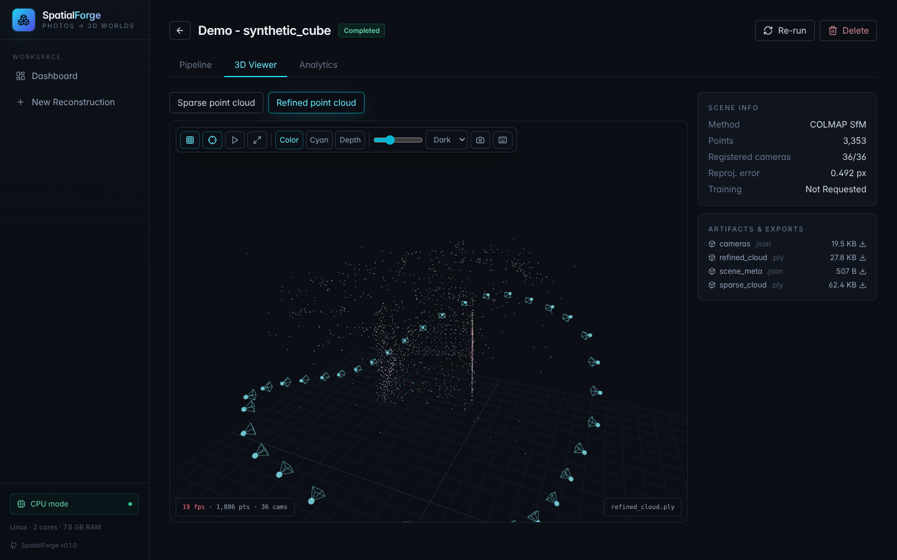
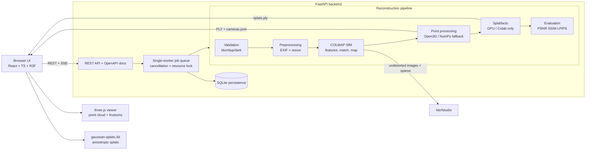
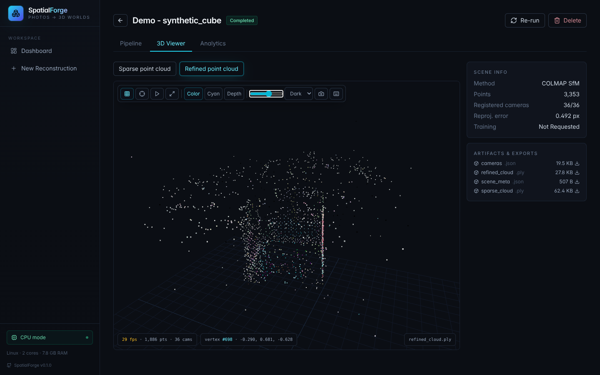
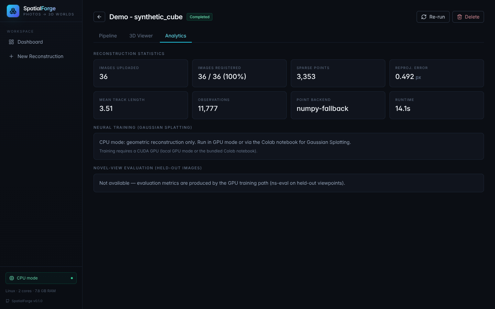

# SpatialForge

[](https://github.com/kayzo001/spatialforge/actions/workflows/ci.yml)
[](LICENSE)


**Transform ordinary photographs into interactive 3D worlds.**

SpatialForge is an open-source, web-based 3D reconstruction workbench: upload
20-150 unordered photos of an object or scene, and it estimates camera poses,
reconstructs sparse geometry, refines the point cloud, optionally trains a
**3D Gaussian Splatting** scene, and lets you explore the result from novel
viewpoints in the browser.

Every pixel of geometry comes from *your* images via real Structure-from-Motion —
no placeholder meshes, no simulated progress, no invented metrics.

> **New here?** [PROJECT_EXPLAINED.md](PROJECT_EXPLAINED.md) is a complete
> narrative walkthrough of the system: every pipeline stage, the architecture,
> the design decisions and what has (and hasn't) been verified.



## Why it matters

Multi-view 3D reconstruction is the geometric backbone of:

- **Robotics** — scene models for navigation and manipulation planning
- **Autonomous systems** — environment priors from onboard camera sweeps
- **Digital twins** — asset capture for industrial inspection and planning
- **AR/VR & spatial computing** — reality capture for immersive content
- **Simulation** — textured, geometrically valid environments
- **Computer vision research** — the SfM stage every NeRF/GS dataset needs

SpatialForge packages that pipeline behind a clean API and UI, and is built
*laptop-first*: the complete geometric pipeline runs on CPU, with GPU training
optional (local NVIDIA or Google Colab).

## Architecture



Full module map and design decisions: [docs/architecture.md](docs/architecture.md).

## How it works (the technical story)

**Structure from Motion.** Uploaded images are validated (readability,
resolution, blur via Laplacian variance, darkness, perceptual-hash duplicates)
and preprocessed non-destructively (EXIF normalization, bounded downscaling).
COLMAP then extracts SIFT features, matches them (exhaustive for ≤ 120 images,
sequential/vocab-tree otherwise), verifies geometry, and runs incremental
mapping with bundle adjustment to recover camera poses and a sparse point
cloud. SpatialForge drives COLMAP through its documented CLI with
version-aware command builders (3.x and 4.x option sets), streaming logs,
exit-code checks and cooperative cancellation.

**Binary model parsing.** The sparse model (`cameras.bin`, `images.bin`,
`points3D.bin`) is parsed in pure Python — no pycolmap build dependency —
including the count-header width change introduced in COLMAP 4.x. Parsing is
unit-tested against hand-built fixtures and validated against COLMAP's own
`model_converter`.

**Coordinate correctness.** COLMAP's OpenCV-convention world-to-camera poses
are converted to camera-to-world OpenGL matrices for the viewer and stored in
`cameras.json`. The conversion is verified in an integration test that
compares estimated poses against *ground-truth* poses from a synthetic
rendered dataset after 7-DoF similarity alignment. See
[docs/coordinates.md](docs/coordinates.md).

**Point-cloud processing.** Statistical outlier removal and voxel
downsampling run on Open3D when available, with an equivalent pure-NumPy
fallback elsewhere; clouds export as binary PLY with per-point color
(plus reprojection error on the sparse cloud).

**Gaussian Splatting.** The undistorted COLMAP layout feeds Nerfstudio
Splatfacto directly. Three presets (Fast Preview / Balanced / High Quality)
map to iterations, downscales and densification settings, auto-reduced for
small GPUs. Training, `ns-eval` (held-out PSNR/SSIM/LPIPS) and `ns-export`
are orchestrated as subprocesses with live log streaming. On machines without
CUDA the app says so and points at the bundled
[Colab notebook](docs/colab.md).

**Evaluation.** PSNR and SSIM are implemented in NumPy/OpenCV (always
available); LPIPS is used when its dependencies exist. Metrics render as
"Not available" rather than fabricated values, and training-image quality is
never presented as novel-view performance. Details and limitations:
[docs/evaluation.md](docs/evaluation.md).

## Screenshots

Refined point cloud of the synthetic demo scene (cameras hidden, hovering a
point shows its index and coordinates):



Analytics for the same run: every registered image, reprojection error and
track statistics come straight from COLMAP's output. Neural-rendering metrics
read "Not available" until a Gaussian Splatting run actually produces them.



The pipeline tab shows live stage progress and the real COLMAP log for the
current run; stages that did not run (e.g. training in CPU mode) are marked
*skipped* rather than shown as done.

## Installation

Prerequisites: Python 3.10-3.12, Node.js ≥ 18 (frontend build), COLMAP
(installer script provided). CUDA is **not** required.

```bash
git clone https://github.com/kayzo001/spatialforge.git
cd spatialforge
python -m venv .venv
```

**Windows (PowerShell)**

```powershell
.venv\Scripts\python -m pip install -r requirements.txt -r requirements-geometry.txt -r requirements-dev.txt
.venv\Scripts\python scripts\install_colmap.py      # downloads COLMAP into tools\colmap (no admin)
cd frontend; npm install; npm run build; cd ..
.venv\Scripts\python scripts\detect_env.py          # confirms what this machine can run
```

**Linux / macOS**

```bash
.venv/bin/python -m pip install -r requirements.txt -r requirements-geometry.txt -r requirements-dev.txt
sudo apt install colmap        # Debian/Ubuntu · Fedora: sudo dnf install colmap · macOS: brew install colmap
(cd frontend && npm install && npm run build)
.venv/bin/python scripts/detect_env.py
```

Detailed steps, GPU-training setup and platform notes:
[docs/installation.md](docs/installation.md).

## Running

```bash
# backend + built frontend on one port
.venv/Scripts/python -m uvicorn backend.app.main:app --port 8000   # Windows
.venv/bin/python -m uvicorn backend.app.main:app --port 8000       # Linux/macOS

# development frontend with hot reload (second terminal)
cd frontend && npm run dev
```

After pulling new frontend code, run `npm run build` again: the backend serves
whatever is in `frontend/dist`.

- App: http://127.0.0.1:8000 (or the Vite dev server on :5173)
- OpenAPI: http://127.0.0.1:8000/docs

### First reconstruction

```bash
python scripts/generate_synthetic_dataset.py   # license-clean sample data with GT poses
python scripts/prepare_demo.py                 # runs the full pipeline into a demo project
```

Or with your own photos: **Dashboard → New Reconstruction** → drop a folder
or ZIP of 20-150 overlapping photos → pick a preset and execution mode →
Start. Capture tips: orbit the subject, keep ~70% overlap between neighbors,
lock focus/exposure, avoid textureless or reflective surfaces.

## Tests

```bash
python -m pytest tests -m "not integration and not gpu"   # unit suite (61 tests)
python -m pytest tests -m "integration"                    # end-to-end w/ real COLMAP
python -m pytest tests                                     # everything
```

The integration test runs the full pipeline and asserts the reconstructed
camera poses match ground truth after similarity alignment — it skips
explicitly when COLMAP is absent rather than faking success. CI runs it on
Ubuntu against the distribution's COLMAP 3.x; the benchmarks below were
measured locally on COLMAP 4.2.1, so both option profiles are exercised.

## Benchmarks

Measured values only (Windows 10, i5-12500H, COLMAP 4.2.1 CPU, Open3D 0.19;
synthetic 36-view 800×600 dataset):

| measurement | value |
|---|---|
| images registered | 36/36 |
| mean reprojection error | 0.41 px |
| CPU pipeline runtime (incl. matching) | ~21 s |
| pose error vs ground truth (7-DoF aligned) | mean 0.32° rotation · 3 cm on 2.1 m orbit |

No GPU-training benchmark is claimed — see docs/evaluation.md for scope and
limitations.

## Google Colab

[notebooks/SpatialForge_Colab.ipynb](notebooks/SpatialForge_Colab.ipynb)
runs the GPU path end-to-end on Colab: hardware detection → pinned
torch 2.4.1+cu121 + Nerfstudio 1.1.3 install → COLMAP SfM → Splatfacto
training → `ns-eval` → `splats.ply` export → download. Guide:
[docs/colab.md](docs/colab.md).

## Hugging Face

Precomputed demo scenes can be published/downloaded via
`scripts/hf_upload.py` / `scripts/hf_download.py` (HF_TOKEN via environment
variable, model-card template in [huggingface/MODEL_CARD.md](huggingface/MODEL_CARD.md)).
No official SpatialForge Hub repository is published yet; URLs will be added
here when one exists.

## Implementation status

| subsystem | status |
|---|---|
| Image upload, ZIP hardening, validation, preprocessing | ✅ implemented & tested |
| COLMAP SfM orchestration (3.x/4.x), cancellation, logging | ✅ implemented & tested on CPU |
| Binary model parser, coordinate transforms | ✅ implemented & tested (unit + GT integration) |
| Point-cloud processing + PLY export | ✅ implemented & tested |
| REST API, SSE live updates, single-worker queue | ✅ implemented & tested |
| three.js point-cloud viewer + camera frustums | ✅ implemented & verified (camera centers match `cameras.json` exactly) |
| Gaussian Splatting path (presets, ns-train/eval/export orchestration) | ✅ implemented, ⚠️ not executed on required hardware here (Colab path provided) |
| Splat rendering in browser (@mkkellogg/gaussian-splats-3d) | ✅ implemented, ⚠️ not exercised with a trained artifact here |
| PSNR/SSIM | ✅ implemented & tested |
| LPIPS / novel-view evaluation | ⚠️ implemented, requires GPU path (ns-eval) |
| Colab notebook | ✅ complete, ⚠️ not executed on Colab hardware |
| Hugging Face publish/download | ✅ scripts complete, ⚠️ no Hub repo published |
| Mesh reconstruction (Poisson etc.) | ❌ not implemented (roadmap) |
| Background masking | ❌ not implemented (roadmap) |

## Research & software references

- Schönberger & Frahm, *Structure-from-Motion Revisited*, CVPR 2016 (COLMAP)
- Kerbl et al., *3D Gaussian Splatting for Real-Time Radiance Field Rendering*, SIGGRAPH 2023
- Mildenhall et al., *NeRF: Representing Scenes as Neural Radiance Fields*, ECCV 2020
- Tancik et al., *Nerfstudio: A Modular Framework for Neural Radiance Field Development*, SIGGRAPH 2024
- Zhang et al., *The Unreasonable Effectiveness of Deep Features as a Perceptual Metric* (LPIPS), CVPR 2018
- Wang et al., *Image Quality Assessment: From Error Visibility to Structural Similarity* (SSIM), IEEE TIP 2004
- Umeyama, *Least-Squares Estimation of Transformation Parameters Between Two Point Patterns*, IEEE TPAMI 1991
- [COLMAP](https://github.com/colmap/colmap) · [Nerfstudio](https://github.com/nerfstudio-project/nerfstudio) ·
  [gsplat](https://github.com/nerfstudio-project/gsplat) · [Open3D](https://github.com/isl-org/Open3D) ·
  [three.js](https://github.com/mrdoob/three.js) · [@mkkellogg/gaussian-splats-3d](https://github.com/mkkellogg/GaussianSplats3D)

## Roadmap

- Poisson/Delaunay surface meshing with a clear mesh-vs-point-cloud distinction
- Vocab-tree matching with a bundled tree for large datasets
- Background masking (rembg) as an optional preprocessing toggle
- Progressive splat streaming and Draco-compressed geometry
- Rig/EXIF-aided camera grouping for video-frame input

## Changelog

See [CHANGELOG.md](CHANGELOG.md) for fixes and changes between versions.

## License

MIT — see [LICENSE](LICENSE). Dependency licenses (COLMAP BSD, Nerfstudio
Apache-2.0, Open3D MIT, …) are compatible; the optional sample-dataset
downloader targets sources free for research use and cites them in-script.

## Repository quality

- CI: GitHub Actions running ruff, the unit suite, the real-COLMAP
  integration test and the frontend build (TypeScript check + Vite)
- Dependabot: pip + npm ecosystems, weekly
- Issue templates: bug report / feature request
- `ruff check backend scripts tests` clean
