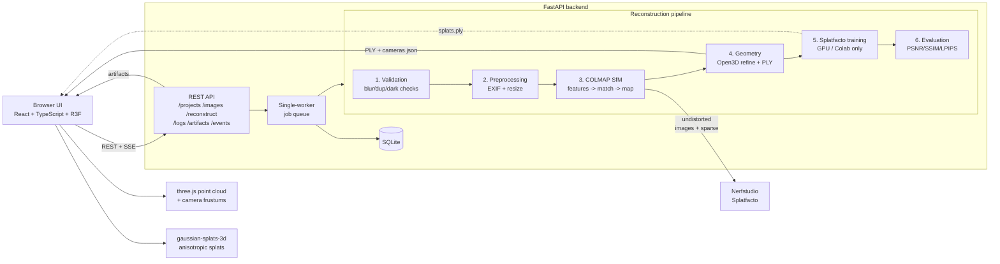

# Architecture

SpatialForge turns unordered photographs into an interactive 3D scene through
a modular pipeline. Every stage is a separate module with an explicit
contract; the HTTP layer never contains reconstruction logic and the
reconstruction code never talks HTTP.



## Module map

```
backend/app/
├── config.py            settings + hardware capability detection (never assumes CUDA)
├── db.py                SQLite persistence (projects, images, jobs, logs, metrics, artifacts)
├── schemas.py           Pydantic API contracts (mirrored by TypeScript types)
├── api/                 HTTP controllers (projects, system) + SSE endpoint
├── services/            upload ingestion, single-worker job manager, event bus, serialization
├── reconstruction/
│   ├── preprocessing/   image validation (blur/duplicate/dark), EXIF-safe resizing
│   ├── colmap/          command builders (3.x/4.x aware), subprocess runner with
│   │                    cancellation, pure-Python binary model parser, coordinate transforms
│   ├── geometry/        point-cloud processing (Open3D + NumPy fallback), PLY/JSON exporters
│   ├── gaussian/        Splatfacto presets + ns-train/ns-eval/ns-export orchestration
│   └── evaluation/      PSNR/SSIM (NumPy), optional LPIPS, deterministic holdout splits
├── workers/             job queue bootstrap
└── utils/               path safety, secure ZIP extraction, logging
```

## Design decisions

**Single-worker queue.** One heavy job runs at a time; additional requests
queue FIFO. This prevents two CUDA trainings (or two giant SfM runs) from
fighting over the same machine. Cancellation is cooperative: the pipeline
checks an event between stages and subprocess runners terminate whole process
trees (psutil).

**Pure-Python COLMAP model parser.** `cameras.bin` / `images.bin` /
`points3D.bin` are parsed directly from the documented binary layout — no
pycolmap compile dependency. The parser handles the count-header width change
between COLMAP 3.x (u32) and 4.x (u64) and is validated against hand-built
fixtures *and* COLMAP's own `model_converter` output.

**Version-aware command builders.** COLMAP 4.x renamed option groups
(`SiftExtraction`→`FeatureExtraction`, `SiftMatching`→`FeatureMatching`).
Builders take a profile detected once from the binary's version banner, so
both release lines work.

**CPU-first geometry.** Validation, preprocessing, SfM orchestration, point
processing (Open3D with an equivalent NumPy fallback), PLY export, metrics
and the viewer all run without a GPU. Neural training is the only CUDA-bound
stage and is guarded by capability detection with a Colab fallback.

**Honest state.** Job state, logs and metrics live in SQLite; the frontend
subscribes over SSE but every value it shows comes from persisted backend
state. Missing capabilities surface as "Not available", disabled UI modes
with explanations — never as simulated progress or invented data.

**Frontend contracts.** `backend/app/schemas.py` (Pydantic) and
`frontend/src/types/index.ts` (TypeScript) mirror each other; the API client
is a thin typed fetch wrapper, and live updates arrive as typed SSE events.
